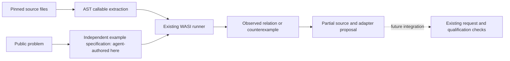

# Discover through behavioral examples: first working prototype

Branch: `feat/behavioral-discovery-prototype`, based on `2bf9568`.

The prototype automatically identifies an internal Coverage.py function that can
perform the region-grouping suboperation requested by an RF-analysis project.
It selects a representation adapter, exposes concrete counterexamples for wrong
bindings, and exports an executable partial-reuse proposal. This is an observed
functional advance over ranking descriptions alone. It is **not yet autonomous
open-world discovery**, a full Spectrace implementation, or evidence that adopting
Coverage.py is preferable to implementing a small local helper.

## Where the existing functional chain stops

- `sources.extract_structure` already parses Python definitions, records source
  spans, signatures and dependencies, and exposes internal mechanisms. Its
  descriptions deliberately do not establish semantics.
- `provider.interpret_capabilities` enriches existing IDs, at most eight per call.
  Inputs, outputs, preconditions and limitations are prose. Public API preference
  can leave useful internal mechanisms unexplored.
- `discovery.problem_queries` reduces those descriptions to at most three lexical
  queries. `select_candidates` fixes the candidate set before independent demand
  interpretation. A later, accurate comparison cannot recover a missed target.
- `provider.interpret_request` already extracts independent, cited requirements.
  `analysis.validate_matches` already retains partial contributions, conflicts,
  unknowns and qualification boundaries. These are valuable downstream contracts.
- The existing `WasiRunner` can execute bounded Python examples without network,
  inherited credentials or persistent writes. No new isolation backend is needed.

## Architectural alternatives considered

| Direction | What it offers | What it cannot establish alone | Decision for this iteration |
| --- | --- | --- | --- |
| Text/code embeddings and broader semantic retrieval | Different vocabulary can enter the candidate pool | A nearby vector does not establish effects, coordinate conventions or runtime fit | Useful possible recall stage; not implemented or benchmarked here |
| Model-generated operational descriptions and analogies | Broad domains, implicit requirements, candidate adapter ideas | A fluent explanation can confuse context, delegation and owned implementation | Reuse the existing Provider later to propose independently cited contracts; no paid call now |
| Static semantic analysis / symbolic reasoning | Relations and preconditions without running the source | Dynamic Python state, dependencies and native code limit coverage; general analysis would be substantial work | Use AST and binding analysis for extractability and attribution, not a new whole-program analyzer |
| **Behavioral examples plus constrained adapters** | Observe transformations, find hidden primitives, produce falsifying examples and runnable proposals | Finite examples and an incomplete adapter vocabulary do not prove general equivalence | **Implemented and executed with the existing WASI runner** |

The intended functional direction is hybrid: independent interpretation proposes
operations/examples; source analysis identifies callable slices; execution checks
the proposed relation; existing qualification reviews the whole request. Neither
the model nor a passed probe can grant full compatibility by itself.



Related primary research motivates semantic/type-directed retrieval and analogical
structure matching: [APIphany](https://arxiv.org/abs/2203.16697) and
[Analogy-Making as a Core Primitive in the Software Engineering Toolbox](https://arxiv.org/abs/2009.06592).
The present code is a small example-driven implementation, not a reproduction of
those systems or a claim to have invented analogical software reuse.

## Implemented functional components

`missing_link/behavioral.py` supplies four ordinary functions:

1. `extract_callables`: parse supplied, pinned public files; find top-level
   synchronous functions regardless of their names; resolve same-file functions,
   literal constants and selected stdlib imports. Unsupported coupling is reported,
   never replaced with invented implementations.
2. `prepare_behavior_search`: combine source slices with example contracts and a
   fixed set of representation adapters into inspectable WASI artifacts.
3. `assess_behavior_search`: retain finite observations, counterexamples, missing
   observations, runtime conflicts and source spans. It produces no qualified leads.
4. `prepare_behavior_bridge`: export the selected source slice, adapter and an
   example check as a partial-reuse proposal.

`missing_link/behavior_examples.py` is the guest calculation copied into the
existing runner. It tests input/output equality, input mutation, separate check
cases, and an ablation that removes the original computation. It is not a process
runner. The two modules introduce no dependencies, transport, scheduler, database,
lease, cache or historical audit. Ordinary Service/Provider/Store execution is
unchanged; this branch exposes an opt-in library prototype rather than silently
executing third-party code in normal Discover jobs.

The intermediate contract is JSON: a cited suboperation, input representation,
calibration examples, separate checks, target runtime and uncovered requirements.
It distinguishes an operator/model specification from code observations and from
target integration. The only adapter alternatives are identity and four combinations
of zero/one-based mask positions with closed/half-open output endpoints. Adapters
contain no grouping algorithm, source-function names or domain-specific matching.

## Corpus and experimental limits fixed before execution

The development corpus is **agent-selected**, not a blind or held-out repository
sample. The coding agent read the source and public problems, then authored the
example contracts. The program chooses the callable and representation binding;
it does not yet translate arbitrary issue prose into examples independently.

Source: `coveragepy/coveragepy@0287d5da35d9dee0f7f464ddb86321e2d0b273cd`,
`coverage/results.py` and `coverage/misc.py`. These provide 24 top-level functions:
12 extracted candidates and 12 explicitly omitted for unresolved/unsupported
coupling. Classes/methods and other files are outside this prototype's coverage.
Original source files, Apache license and notice are retained as text fixtures.

Five public problems are retained for a local retrieval comparison. Three receive
operational example contracts: RF grouping, genomic interval union, and one-to-one
pedestrian assignment. The other two are not behaviorally assessed. The eight
contracts also include a source-operation probe and synthetic negative controls
for zero indices, numeric gaps, conflicting runtime and unknown runtime.

The exact corpus, eight contracts, five adapter choices and acceptance criterion
were fixed in `tests/fixtures/behavioral_discovery/protocol.json` and `contracts.json`
before execution. No failed example was removed and no adapter or weight was added
after observing the outcome. Checks exhaust small boolean masks and use a separate
oracle based on runs in a binary string. They test unseen inputs, not unseen source
families or independently authored interpretations.

Protocol SHA-256: `cf132590cfd2554bcababe76a179757f3ec14d7712e4877bbafec1b07cdcae2a`.
Contracts SHA-256: `32052b729aeff847ffccd170bf1b8f3d9c7609542b923eb4abc36b1cf7e173d3`.

## Concrete cross-domain result

[Coverage.py `_line_ranges`, lines 422–446](https://github.com/coveragepy/coveragepy/blob/0287d5da35d9dee0f7f464ddb86321e2d0b273cd/coverage/results.py#L422-L446)
groups selected positive integer positions into maximal runs relative to a supplied
ordered universe. The source owns the loop, boundary detection and endpoint
emission. Its original purpose is reporting uncovered source lines.

[Spectrace #35](https://github.com/sarahmorar/Spectrace/issues/35) requests grouping
detected frequency bins into transmissions. One suboperation maps a boolean mask
to contiguous detected regions, including singleton bins. The retrieved issue was
open with no comments; the retained target tree and Python/NumPy manifest are pinned
at `c2ac62c145a75958207b674b9d8b9313c3fe55a0`. This is limited target context, not a
proof of novelty, lack of another implementation, or maintainer interest.

The automatically selected binding is:

```text
mask:       F F T T T F T
universe:   1 2 3 4 5 6 7
selected:       3 4 5   7
source:     [(3, 5), (7, 7)]              # closed, one-based
adapter:    [[2, 5], [6, 7]]              # zero-based, half-open
```

| Question | Observed result |
| --- | --- |
| Does the hidden source implement ordered-subset runs? | 3 calibration examples and 126 separate checks pass |
| Can it provide RF region boundaries after representation conversion? | 4 calibration examples and 123 separate checks pass |
| Does the adapter alone supply the algorithm? | No: identity substitution passes 0/127 RF cases |
| Does direct identity binding find the RF relation? | No supported call signature/binding |
| Can the exported proposal reproduce the result? | 127/127 cases pass in a separate WASI execution |
| Has Spectrace been integrated or its full request satisfied? | No |

The bridge accepts ordinary boolean lists. Actual NumPy input/validation,
Spectrace-specific errors, frequency/power alignment, the Transmission dataclass,
center/peak/bandwidth calculations, noise-floor metadata and the target test suite
remain unimplemented. This is a reusable segmentation primitive, not an RF detector.

There is also a practical adoption question: this is a small internal helper whose
API is not public. A straightforward local or NumPy implementation may be simpler
and faster than carrying an extraction. The experiment demonstrates the functional
relationship, not net engineering benefit or a recommendation to depend on Coverage.py.

## Falsification and constraints

- **Similar terminology, incompatible operation:** with universe and selection
  `[1,3,4]`, the helper returns `[[1,4]]`. A numeric-adjacency requirement expects
  `[[1,1],[3,4]]`. The same word “range” hides a different relation.
- **Precondition failure:** direct zero-based input `[0,1,2]`, selected `[0,1]`,
  produces `[[1,1]]`. The source uses a truthiness sentinel. The zero-origin mask
  adapter also loses the leading detection; the one-origin adapter passes.
- **Format mismatch:** genomic interval union and assignment examples find no
  passing callable/binding. This is failure within the supported adapter language,
  not proof that no wider algorithmic adaptation exists.
- **Runtime conflict:** the same passing RF behavior under a synthetic JavaScript-only
  target remains `runtime_blocked`; an unspecified target remains `runtime_unknown`.
- **Unknowns:** omitted functions, unassessed corpus problems, target integration,
  full requirement fulfillment and novelty are not converted into negatives or positives.

The search made 110 callable/contract/adapter attempts, with no load errors and no
missing eligible observations. Each selected result remains unqualified.

## Comparison with the existing selection path

The unchanged `2bf9568` `problem_queries` and `select_candidates` were applied to a
common five-problem local pool. Source capabilities came from structural extraction,
without native model enrichment. Each query receives the same frozen pool order;
state is normalized open for this controlled comparison only. This is **not an
end-to-end GitHub retrieval or paid-model baseline**.

The three generated queries center on file reporting, module isolation and context
managers. The top three are Impulse statistics, screenshot-history grouping and
CrossMap ranges; Spectrace is absent. Behavioral matching instead identifies the
RF suboperation and an executable binding. This illustrates a recoverable miss in
this curated corpus. It does not establish a general precision/recall improvement
over the model-enriched production pipeline or the earlier 48-body experiment.

Identity-only behavioral binding finds the source probe but no RF match. Allowing
the fixed representation conversions adds that relation. The negative operation
and runtime cases remain failures/blocked cases, rather than becoming extra positives.

## Cost, validation and retained artifacts

The plan took approximately 84 ms to prepare. The first WASI search took 4.489 s;
the separate exported-proposal check took 1.794 s. These are single-run wall times,
including existing sandbox setup, not performance benchmarks. No paid calls,
historical budget reservations, source-package installs or target executions occurred.

The machine-readable summary and proposal are in
`tests/fixtures/behavioral_discovery/experiment-result.json` and `proposal.json`.
Original local plans and WASI receipts remain under the new ignored
`data/behavioral-discovery-2026-10-11/` directory. Initial fixture writing appended
one terminal LF; restoring exact acquired source blobs left every executed artifact
hash unchanged. The original plan/receipts remain intact and the corrected source
attribution is retained separately in `plan-exact-snapshot.json`.

To prepare the same experiment from the retained fixtures, use the following
from the repository root. Only the explicit `runner.run` line executes acquired
code, through the already configured WASI sandbox; it makes no network/model calls.

```python
import json
from pathlib import Path
from missing_link.behavioral import prepare_behavior_search, assess_behavior_search
from missing_link.wasi_runner import WasiRunner

root = Path("tests/fixtures/behavioral_discovery")
meta = json.loads((root / "provenance.json").read_text(encoding="utf-8"))
snapshot = {
    "full_name": meta["source"], "revision": meta["revision"], "public": True,
    "files": [{"path": f["path"], "text": (root / f["fixture"]).read_text(encoding="utf-8")}
              for f in meta["files"]],
}
contracts = json.loads((root / "contracts.json").read_text(encoding="utf-8"))
plan = prepare_behavior_search(snapshot, contracts)
runner = WasiRunner()
execution = runner.run(plan["files"], plan["entrypoint"])
result = assess_behavior_search(plan, execution)
print(json.dumps(result, indent=2))
```

An unavailable runtime returns `not_evaluated`; there is no host-execution fallback.

Acquired code was executed only inside the existing WASI runtime. Host unit tests
execute only explicitly authored test functions; downloaded fixtures are parsed as
text. Tests cover closure resolution, non-execution of module initialization,
unchanged decorators, unsupported coupling, source bounds/redaction, mutation,
counterexamples, holdout failure, representation types, runtime conflict/unknowns,
missing observations and export separation from integration.

Local validation completed without failures:

| Check | Result |
| --- | --- |
| Complete suite, Windows / Python 3.13.5 | 1,847 tests, 1 skipped, 1,168.087 s |
| Complete suite, Ubuntu WSL / Python 3.12.3 | 1,847 tests, 43 skipped, 1,013.415 s |
| Latest focused regressions, both systems | 22 passed on each |
| Application `--help`, both systems | Passed |
| Staged whitespace check | Passed |

The complete suites collected the earlier 20-test prototype module. The latest
22-test focused run verifies the final missing-observation handling and export
changes; no existing production module was edited. Full-suite logs are retained
in the new experiment directory. The existing GitHub Actions matrix remains
Windows/Linux × Python 3.10/3.13. The branch is now published as draft PR #114;
the complete hosted matrix on the latest head remains required before merge.

The publication review reproduced an export mismatch for generator-valued
functions: discovery normalized their output, while the exported check attempted
direct JSON serialization. Exported checks now reuse the existing guest evaluator's
normalization and strict equality, including boolean/number distinctions. The
authored generator regression passes on both systems, and the updated RF proposal
replays all 127 cases inside WASI. Its new receipt is retained separately as
`data/behavioral-discovery-2026-10-11/proposal-replay-pr114.json`; the original
experiment fixtures and receipts have not been rewritten.

## Next functional step

Keep this as a reviewable prototype until the existing Provider can independently
propose cited operation examples and preconditions for unseen sources/problems.
Use this same example contract, existing source acquisition, existing WASI runner,
existing account/budget controls and existing request/qualification records.

The next evaluation should separate source-family holdout from input holdout and
compare model-proposed contracts against independent technical review. It should
measure newly recovered functional relations, counterexamples, missed primitives,
adapter cost and target-specific work. At least one larger capability should show
that reuse saves meaningful implementation effort. A useful outcome could also be
that extracting small helpers is usually uneconomic.

This is the remaining functional uncertainty. It does not call for another runner,
global audit, coordination layer or infrastructure PR.
